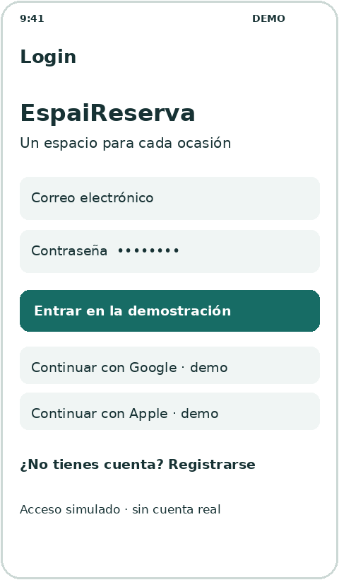
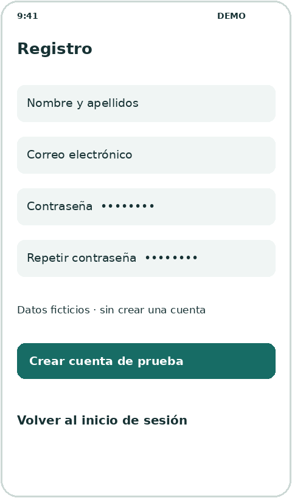
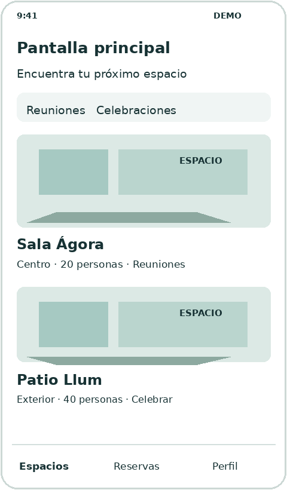
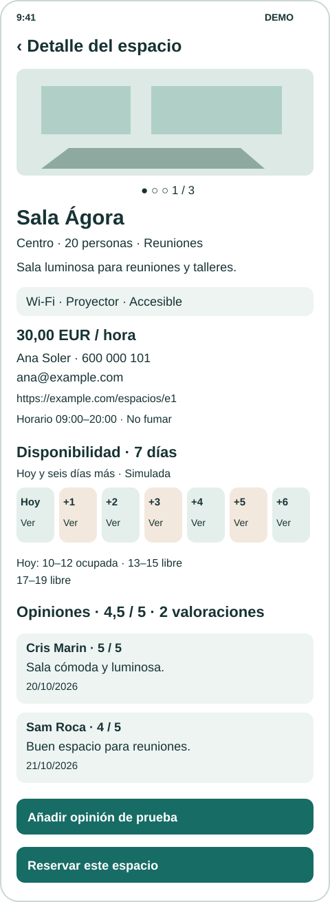
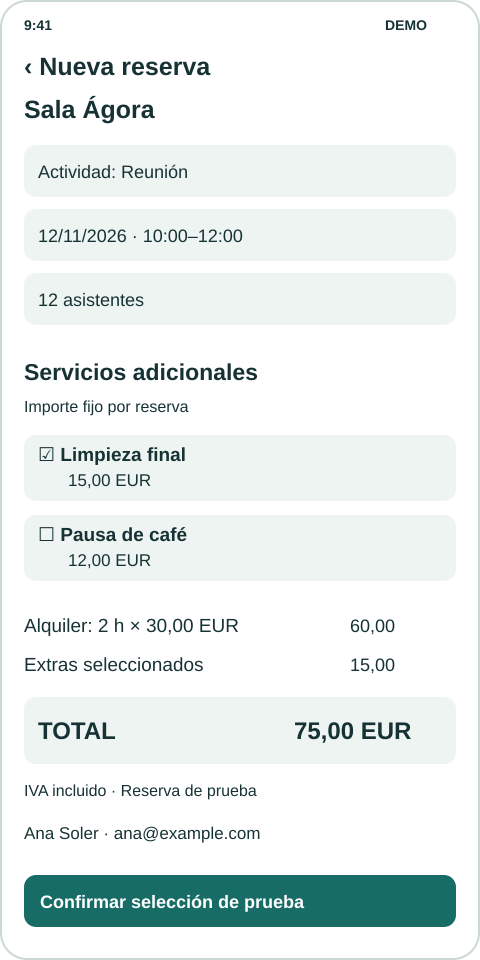
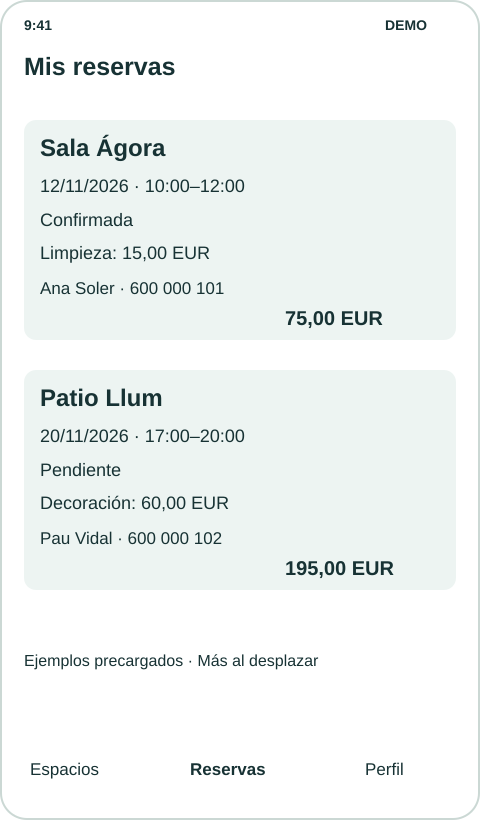
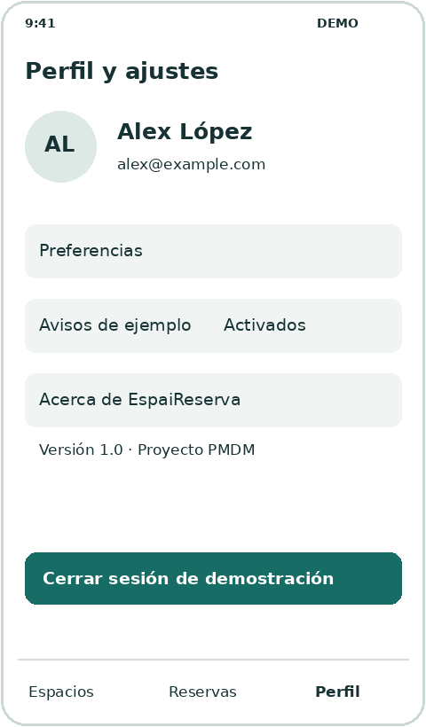

La capa de presentación vive en `lib/ui/`. Las pantallas muestran modelos de dominio, comunican acciones y permiten recorrer la aplicación. Los componentes visuales se agrupan por funcionalidad o se comparten en `lib/ui/core/ui/`.

## Libertad de diseño y pantallas mínimas

Debes implementar **al menos siete pantallas**: login, registro, principal, detalle de un espacio, nueva reserva, mis reservas y perfil con ajustes. Puedes añadir otras, como una confirmación independiente, siempre que las siete mínimas sigan siendo identificables y cumplan sus requisitos.

**Los mockups y las propuestas de distribución son orientativos.** Puedes diseñar las pantallas como consideres, elegir otra identidad y cambiar su composición. Mantén los datos mínimos, las acciones y la navegación exigidos. No se evaluará que tu aplicación copie los dibujos, sino que resuelva el recorrido y sea legible y coherente.

## Un estilo coherente en toda la aplicación

Antes de implementar las pantallas, acuerda unos criterios visuales sencillos y anótalos en el `README`. Deben aplicarse también a las pantallas que añadas. Como punto de partida:

- Elige una paleta reducida con un color principal, colores de fondo y texto y colores para los estados. Mantén el mismo significado en toda la aplicación y acompaña los estados con texto.
- Define una jerarquía de textos: título de pantalla, título de sección, texto normal y texto secundario. Repite los tamaños y pesos elegidos para cada función.
- Utiliza una escala pequeña de separaciones, por ejemplo 8, 16 y 24 píxeles lógicos. Mantén márgenes y alineaciones consistentes.
- Da el mismo aspecto a las acciones equivalentes. El botón principal debe destacar de la misma forma; los secundarios y las acciones de volver deben resultar reconocibles.
- Conserva criterios comunes para tarjetas, bordes, esquinas, iconos e imágenes. Comprueba contraste, lectura de textos largos y desplazamiento en pantallas pequeñas.

Estas son pautas de coherencia para esta entrega. **Cuando aprendamos a gestionar los estilos de Flutter de forma adecuada, centralizaremos su configuración.** Ahora aplica los criterios elegidos en tus componentes; no se exige implementar todavía un sistema global de temas ni paquetes de estilos.

## Crear los componentes que se repiten

Si detectas un patrón reutilizable, **debes extraerlo a un componente propio**, igual que estamos haciendo en el [catálogo de componentes](../../../widgets/configuracion-de-un-asistente-de-ia/el-proyecto-del-catalogo/). No te limites a las tarjetas propuestas: revisa también los botones, los tipos de texto, los campos con una apariencia común o las filas de icono y etiqueta.

Por ejemplo, un `BotonPrincipal` puede recibir el texto y la acción, un `TituloSeccion` el texto que debe mostrar, y `EspacioTarjeta` los datos del espacio y la acción de abrirlo. Utiliza parámetros para expresar las variantes de contenido, aspecto y comportamiento; evita crear una clase distinta para cada texto o color. Reutilizar significa utilizar ese mismo componente en los lugares donde se repite el patrón.

- Guarda los componentes compartidos en `lib/ui/core/ui/` y los específicos en `lib/ui/<funcionalidad>/ui/`.
- Separa el contenido del aspecto: el texto o el espacio recibido no deben quedar fijados dentro de una pieza reutilizable.
- Haz que las pantallas compongan esos componentes, en lugar de copiar su árbol de widgets en varios archivos.
- Comprueba sus variantes con datos distintos, como en el catálogo: textos largos, botones principales y secundarios, estados de reserva y tarjetas con diferente información.

La extracción de componentes ya permite aplicar las mismas decisiones visuales en varios lugares. Es compatible con centralizar los estilos más adelante.

## Recorrido obligatorio


Login ↔ Registro; Login → Principal → Detalle → Nueva reserva → confirmación simulada → Mis reservas. Desde Principal, Mis reservas y Perfil debe poder cambiarse entre esas tres secciones mediante una navegación coherente. Puedes usar NavigationBar, Drawer o un menú equivalente.

Usa Navigator y MaterialPageRoute o una solución equivalente que puedas explicar. Detalle y Nueva reserva deben permitir volver. Tras entrar, Atrás no debe regresar al login; al cerrar sesión debe volver al login y limpiar las pantallas anteriores. El espacio seleccionado debe conservarse durante el recorrido.

## Login

Acceso simulado a la aplicación.



Ejemplo orientativo con datos simulados

### Requisitos mínimos

- Muestra el nombre o logotipo, un mensaje de bienvenida, los campos de correo y contraseña y un botón de acceso. La contraseña debe aparecer oculta.
- Incluye al menos dos botones de acceso social, por ejemplo Google y Apple. Al pulsarlos se accede con el usuario ficticio y se identifica el acceso como simulado; no se conectan cuentas externas.
- Permite acceder con datos de demostración sin comprobar credenciales ni conectarse a un servidor. Identifica el acceso como simulado.
- El botón abre la pantalla principal. Configura la navegación para que Atrás no vuelva a esta pantalla después del acceso.
- Incluye un enlace Registrarse que abra la pantalla de registro y permita volver al login.
- Adapta el contenido al teclado y al alto disponible mediante desplazamiento cuando sea necesario.

Comprobación: Pulsa Entrar y comprueba que se abre el catálogo. Vuelve al login desde Cerrar sesión y revisa que puedes acceder otra vez.

## Registro

Presentación de un alta de usuario ficticia.



Ejemplo orientativo con datos simulados

### Requisitos mínimos

- Muestra nombre y apellidos, correo, contraseña y repetición de contraseña con etiquetas visibles. Los campos de contraseña deben ocultar el texto.
- Puedes precargar los campos; no se exige validación, guardar los datos ni crear una cuenta real. Identifica el registro como una simulación.
- Crear cuenta de prueba muestra una confirmación simulada y permite regresar al login. Entrar en la aplicación sigue realizándose desde el login.
- Incluye Volver al inicio de sesión y permite regresar mediante Atrás. No almacenes contraseñas en `Usuario` ni en su DTO.

Comprobación: Abre Registro desde Login, activa la confirmación y regresa al acceso. Comprueba también el botón Atrás.

## Pantalla principal

Catálogo de espacios disponibles en la demostración.



Ejemplo orientativo con datos simulados

### Requisitos mínimos

- Muestra al menos seis espacios distintos mediante una lista o cuadrícula desplazable, con datos procedentes de los modelos.
- Cada tarjeta incluye imagen, nombre, ubicación, aforo y al menos una actividad admitida. Reutiliza un componente `EspacioTarjeta`.
- La pulsación sobre cualquier tarjeta abre el detalle de ese espacio. Comprueba también una tarjeta situada al `final` del listado.
- Ofrece acceso visible a Mis reservas y Perfil. Si añades categorías o un buscador decorativo, indícalo como vista de ejemplo; los filtros funcionales son una ampliación.

Comprobación: Abre dos espacios diferentes y comprueba que sus detalles cambian. Revisa el desplazamiento hasta el último elemento.

## Detalle de un espacio

Información completa del espacio seleccionado.



Ejemplo orientativo con datos simulados

### Requisitos mínimos

- Muestra nombre, descripción, ubicación, aforo y actividades admitidas. Sustituye la imagen única por un carrusel con al menos tres imágenes del espacio recibido, desplazable horizontalmente y con indicador de posición.
- Incluye al menos tres elementos de equipamiento o servicios, representados mediante iconos y texto.
- Muestra la tarifa por hora con moneda, y la persona de contacto del local con nombre, teléfono y correo. Usa datos ficticios.
- Presenta condiciones y horario de uso. Muestra la web del local si existe y «Sin sitio web» si es `null`; basta mostrarla como texto, sin incorporar paquetes para abrir enlaces.
- Muestra la disponibilidad de hoy y los seis días siguientes, con fecha y franjas libres u ocupadas. Usa texto además del color e indica «Disponibilidad simulada»; no se exige bloquear franjas ni enlazarlas con una reserva real.
- Muestra las opiniones con autor, fecha, comentario y puntuación de 1 a 5; incluye media y número de valoraciones, o «Sin valoraciones». Permite añadir una opinión de prueba con texto y puntuación, utilizando estado local.
- El botón Reservar abre Nueva reserva con el mismo espacio. La acción de volver regresa al catálogo.

Comprobación: Abre dos espacios. Cambian la galería, los comentarios, la media, la web y la disponibilidad. En Jardin Brisa debe aparecer «Sin valoraciones». Añade una opinión de prueba y comprueba que desaparece al salir y volver a abrir el detalle. Reserva Patio Llum y comprueba que se conserva ese espacio.

## Nueva reserva

Presentación de una solicitud de reserva de prueba.



Ejemplo orientativo con datos simulados

### Requisitos mínimos

- Identifica el espacio elegido e incluye actividad, fecha, hora de inicio, hora de fin y número de asistentes.
- Presenta actividad, fecha, horario y asistentes mediante controles con etiquetas visibles. Puedes precargarlos sin edición. La selección de servicios adicionales sí debe responder a las pulsaciones; no se exige validación completa de formularios.
- El ejemplo debe ser coherente: actividad admitida, asistentes dentro del aforo y hora de fin posterior a la de inicio. Puedes generar el ejemplo a partir del espacio recibido.
- Muestra los servicios que ofrece ese espacio mediante opciones seleccionables con su nombre y precio final por reserva. Permite elegir ninguno, uno o varios; no confundas los extras con el equipamiento incluido.
- Muestra duración, tarifa por hora, subtotal de alquiler, subtotal de extras, total y moneda, además del contacto del local. Actualiza los importes con cada selección: total = tarifa × horas + extras.
- La confirmación debe conservar el mismo espacio, los servicios seleccionados y el desglose de precio; no añade una reserva a la fuente simulada.
- Confirmar muestra un diálogo o pantalla con el resumen incluido el precio total, y el mensaje `Reserva` de prueba. Desde esa confirmación permite abrir Mis reservas.
- Explica que no se guarda la solicitud y que Mis reservas contiene ejemplos precargados. Volver debe permitir regresar al detalle del mismo espacio.

Comprobación: En Sala Ágora, dos horas cuestan 60,00 €. Seleccionar limpieza suma 15,00 €, seleccionar también café suma otros 12,00 € y desmarcarlos devuelve el total a 60,00 €. La confirmación conserva las selecciones y Mis reservas sigue mostrando los datos precargados.

## Mis reservas

Consulta de reservas ficticias precargadas.



Ejemplo orientativo con datos simulados

### Requisitos mínimos

- Muestra al menos dos reservas con nombre del espacio, actividad, fecha, horario, asistentes, estado y precio total con moneda. Incluye los servicios contratados y su coste, o «Sin extras».
- Diferencia visualmente al menos dos estados, como Confirmada y Pendiente. Acompaña el color con texto legible.
- Incluye el nombre y al menos un medio de contacto de la persona responsable del local, accesibles en la tarjeta o en un detalle de la reserva.
- Reutiliza un componente `ReservaTarjeta`. Los datos deben relacionarse con espacios existentes del catálogo.
- Incluye navegación hacia Espacios y Perfil. No se exige cancelar o modificar reservas; si añades estos botones, deben explicar su comportamiento simulado.

Comprobación: Comprueba que ambas reservas se leen completas y que sus estados se distinguen sin depender exclusivamente del color.

## Perfil y ajustes

Información del usuario y de la aplicación.



Ejemplo orientativo con datos simulados

### Requisitos mínimos

- Muestra avatar o iniciales, nombre y correo de un usuario ficticio coherente en toda la aplicación.
- Incluye una sección de preferencias y otra con nombre de la aplicación, versión y breve descripción del proyecto.
- Puedes representar una preferencia con un valor fijo identificado como ejemplo. En esta entrega basta mostrar ese valor de ejemplo.
- El botón Cerrar sesión vuelve al login y elimina las rutas anteriores. Tras salir, Atrás no debe reabrir el perfil ni el catálogo.
- Incluye acceso a Espacios y Mis reservas con el mismo patrón de navegación que el resto de secciones principales.

Comprobación: Cierra sesión y pulsa Atrás. Comprueba que las pantallas de la sesión cerrada no quedan accesibles.


## Cómo resolver las nuevas interacciones

Estas interacciones usan **estado local de una pantalla**, como los ejemplos con `StatefulWidget` y `setState` del catálogo. No se exige todavía una solución de estado compartido. Revisa [Gestos y actualización](../../../widgets/otros/gestos-y-actualizacion/) si necesitas recordar cómo reconstruir la interfaz al cambiar un valor.

### Carrusel con PageView

`PageView` permite desplazarse por páginas de forma horizontal. Dentro de una pantalla con desplazamiento vertical necesita una altura limitada. Este **fragmento para el cuerpo del detalle** presupone un `Espacio espacio` y las imágenes declaradas en `pubspec.yaml`:

```dart
SizedBox(
  height: 220,
  child: PageView.builder(
    itemCount: espacio.imagenesAssets.length,
    itemBuilder: (context, indice) => Image.asset(
      espacio.imagenesAssets[indice],
      fit: BoxFit.cover,
    ),
  ),
)
```

El índice selecciona una ruta de `imagenesAssets`. Añade `onPageChanged` para guardar la página actual con `setState` y mostrar una etiqueta como «1 / 3». La lista de imágenes debe estar completa y no vacía; mientras incorporas recursos puedes sustituir cada imagen por un `Placeholder`.

### Seleccionar servicios y recalcular el resumen

En el `State` de Nueva reserva puedes conservar un conjunto de identificadores. `CheckboxListTile` combina una casilla y un texto; su propiedad `value` indica si está marcada y `onChanged` recibe el nuevo valor. Este **fragmento va dentro del State**:

```dart
final _serviciosSeleccionados = <String>{};

void _cambiarServicio(ServicioExtra servicio, bool seleccionado) {
  setState(() {
    if (seleccionado) {
      _serviciosSeleccionados.add(servicio.id);
    } else {
      _serviciosSeleccionados.remove(servicio.id);
    }
  });
}
```

El `Set` evita identificadores duplicados. Para dibujar cada opción, este **fragmento de widget** presupone un `ServicioExtra servicio` de la lista del espacio:

```dart
CheckboxListTile(
  title: Text(servicio.nombre),
  subtitle: Text('${(servicio.precioCentimos / 100).toStringAsFixed(2)} EUR'),
  value: _serviciosSeleccionados.contains(servicio.id),
  onChanged: (valor) => _cambiarServicio(servicio, valor ?? false),
)
```

Dentro de `build`, obtén los servicios cuyo identificador está seleccionado y suma sus precios con `fold`, como en el dominio. El subtotal de alquiler se obtiene del intervalo de prueba. Pasa una copia de los servicios elegidos y los importes al resumen de confirmación. El Estado de esta pantalla se descarta al salir; el repositorio no se modifica.

### Añadir una opinión de prueba

Muestra los comentarios precargados y conserva los nuevos en una lista local del detalle. Un campo de texto, una selección sencilla de 1 a 5 y un botón son suficientes. Explica esos controles en tu interfaz y comprueba al pulsar que `texto.trim()` no esté vacío y que la puntuación esté dentro del intervalo. Muestra un mensaje si falta alguno; no se exige utilizar `Form` ni validadores.

Al aceptar, utiliza el usuario de demostración como autor y `DateTime.now()` como fecha, incorpora la opinión a la lista visible y recalcula su media y contador con `setState`. La colección del servicio permanece intacta. Libera el controlador de texto en `dispose` si utilizas uno. Al cerrar el detalle y abrirlo de nuevo solo deben quedar las opiniones precargadas.

### Mostrar la semana simulada

Consulta `DisponibilidadRepository.obtenerSieteDias(espacio.id, fechaReferencia)`. Recibe `fechaReferencia` por constructor desde el arranque, con el valor de `fechaReferenciaDemo`; no importes el archivo de datos ficticios en la pantalla. Puedes utilizar una lista horizontal o bloques con fecha y franjas; limita su altura si la anidas en otro desplazamiento. Se deben poder consultar los siete días, aunque no quepan simultáneamente en pantalla. «Libre» y «Ocupada» deben seguir siendo comprensibles sin depender del color.
