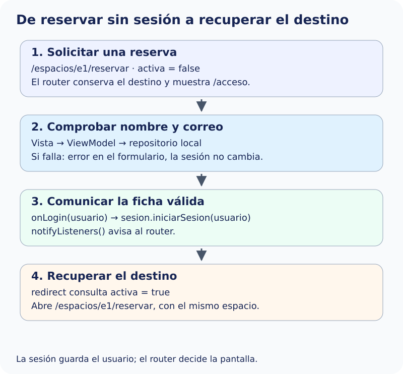

Configura con `go_router` qué pantalla debe abrirse en cada ruta y qué información necesita para mostrar su contenido. El recorrido debe funcionar al pulsar los botones de la interfaz y al abrir directamente una dirección de la aplicación. Por ejemplo, en `/espacios/:id`, el parámetro `:id` identifica el espacio que se debe consultar, aunque no se haya abierto antes el catálogo.

La navegación también debe conservar el estado al cambiar entre Espacios, Mis reservas y Perfil. Distingue las pantallas públicas de las que requieren sesión y comprueba, además, a quién pertenece cada reserva. Una ruta desconocida, la ausencia de sesión y la falta de permiso son situaciones diferentes; las tablas siguientes indican cómo responder en cada caso.

Los apartados siguientes concretan las rutas que debes crear y el comportamiento esperado en cada pantalla. Para implementar la sesión y las redirecciones, utiliza el ejemplo de [Acceso a rutas protegidas de los apuntes](../../../formularis-i-navegacio/navegacion-avanzada/rutas-protegidas/), adaptándolo a los destinos y permisos de esta aplicación.

## Mapa de rutas y parámetros

Usa un único `MaterialApp.router`. Las direcciones son orientativas; se evalúa el comportamiento.

| Ruta | Acceso | Destino |
| --- | --- | --- |
| `/acceso` | Público | Formulario de acceso. |
| `/registro` | Público | Formulario de registro y creación de usuario. |
| `/espacios` | Público | Catálogo. |
| `/espacios/:id` | Público | Detalle por identificador. |
| `/espacios/:id/reservar` | Protegido | Formulario del espacio indicado. |
| `/espacios/:id/reservar/revision` | Protegido | Revisión del borrador del mismo espacio. |
| `/reservas` | Protegido | Reservas del usuario actual. |
| `/reservas/:id` | Protegido | Confirmación o detalle de una reserva propia. |
| `/perfil` | Protegido | Perfil y cierre de sesión. |

Una ruta desconocida muestra una pantalla propia de «Página no encontrada», con una composición visual cuidada y coherente con la identidad de la aplicación. Incluye un título claro, un mensaje breve y una ilustración o un recurso gráfico que acompañe el estado.

Prueba destinos directos iniciando la aplicación en esas ubicaciones mediante un mecanismo de desarrollo que documentes. No se exige configurar enlaces externos de Android o iOS.

## Navegación entre secciones

Permite navegar entre Espacios, Mis reservas y Perfil mediante el tipo de navegación que prefieras: barra inferior, menú lateral, pestañas u otra solución coherente con el diseño de la aplicación. Conserva al menos el desplazamiento del catálogo y la navegación de cada sección al alternar. Los filtros son una ampliación.

Como sugerencia, puedes utilizar `StatefulShellRoute.indexedStack`, estudiada en los apuntes, para mantener el estado y la navegación de las secciones.

## Comportamiento del acceso y de los permisos

Una ruta protegida solo se puede abrir con una sesión activa. En el detalle de una reserva debes comprobar también que su propietario sea el usuario que ha iniciado sesión. Aplica ambas comprobaciones al navegar desde la interfaz y al abrir directamente una ruta.

### Acceso — `/acceso`

| Tipo de acceso o situación | Comportamiento esperado |
| --- | --- |
| Sin sesión | Muestra el formulario de acceso. |
| Campos vacíos o mal formados | Muestra los errores junto a los campos y permite corregirlos. |
| Nombre o correo incorrectos | Permanece en esta pantalla y muestra «Los datos de acceso no son correctos». No inicia sesión ni pierde el destino pendiente. |
| Datos correctos | Inicia sesión y recupera el destino interno pendiente; si no existe, abre `/espacios`. Antes de mostrar el contenido del destino, comprueba que el usuario tenga permiso para consultarlo. |
| Con sesión activa | Continúa al destino interno pendiente o, si no existe, a `/espacios`, sin pedir de nuevo los datos de acceso. |

### Registro — `/registro`

| Tipo de acceso o situación | Comportamiento esperado |
| --- | --- |
| Sin sesión | Permite completar el registro. Si los datos son válidos y el correo no está registrado, crea el usuario y vuelve a Acceso con nombre y correo precargados, sin iniciar sesión. Conserva el destino pendiente. |
| Con sesión activa | Redirige a `/espacios`; no sustituye al usuario actual ni crea otra sesión. |
| Datos incorrectos o correo ya registrado | Permanece en Registro, muestra los errores y no crea ningún usuario. |

### Catálogo — `/espacios`

| Tipo de acceso o situación | Comportamiento esperado |
| --- | --- |
| Sin sesión o con sesión activa | Muestra los espacios y permite abrir sus detalles. No exige acceso para consultar el catálogo. |

### Detalle de un espacio — `/espacios/:id`

| Tipo de acceso o situación | Comportamiento esperado |
| --- | --- |
| Espacio existente, sin sesión o con sesión | Muestra la información del espacio. |
| Espacio inexistente | Muestra «Espacio no encontrado» y no permite iniciar su reserva. |
| Pulsa Reservar sin sesión | Abre `/acceso` conservando como destino el formulario de reserva de ese espacio. |
| Pulsa Reservar con sesión | Abre el formulario de reserva del mismo espacio. |

### Nueva reserva — `/espacios/:id/reservar`

| Tipo de acceso o situación | Comportamiento esperado |
| --- | --- |
| Sin sesión | Redirige a `/acceso` y conserva el destino. No muestra el formulario protegido. |
| Con sesión y espacio existente | Permite completar el formulario. El borrador corresponde al espacio y al usuario actuales. |
| Con sesión y espacio inexistente | Muestra «Espacio no encontrado» y no permite crear una reserva. |
| La sesión pertenece a un usuario distinto del que inició el borrador | Descarta el borrador anterior y abre un formulario nuevo para el usuario actual. |

### Revisión — `/espacios/:id/reservar/revision`

| Tipo de acceso o situación | Comportamiento esperado |
| --- | --- |
| Sin sesión | Redirige a `/acceso` conservando el destino, sin mostrar el borrador. |
| Con sesión y borrador válido del mismo espacio y usuario | Muestra el resumen y permite volver a editar o confirmar. Al confirmar, asigna la reserva al usuario de sesión, nunca a un identificador de la URL o de un campo editable. |
| Con sesión, sin borrador válido o con borrador de otro espacio o usuario | Vuelve al formulario del espacio solicitado sin crear ninguna reserva ni mostrar datos del borrador ajeno. |
| Con sesión y espacio inexistente | Muestra «Espacio no encontrado». |
| La reserva se ha confirmado correctamente | Abre `/reservas/:id` con el identificador de la reserva creada. Desde esa pantalla, el botón «Ver mis reservas» lleva a `/reservas`. Atrás no vuelve a la revisión para repetir el envío. |

### Mis reservas — `/reservas`

| Tipo de acceso o situación | Comportamiento esperado |
| --- | --- |
| Sin sesión | Redirige a `/acceso` y conserva el destino, sin mostrar reservas. |
| Con sesión y reservas propias | Muestra únicamente las reservas del usuario actual. |
| Con sesión, sin reservas propias | Muestra una lista vacía con un mensaje explicativo; no es un error de acceso. |
| Accede después de cambiar de usuario | Recarga las reservas del nuevo usuario sin mostrar las del anterior. |

### Detalle o confirmación de reserva — `/reservas/:id`

| Tipo de acceso o situación | Comportamiento esperado |
| --- | --- |
| Sin sesión | Redirige a `/acceso` y conserva el destino, sin mostrar datos de la reserva. |
| Con sesión y reserva propia existente | Muestra los detalles de esa reserva. |
| Con sesión y reserva de otro usuario | Muestra «Reserva no disponible», sin titular, espacio, fechas, importes ni acciones sobre la reserva. Mantiene la sesión actual y no vuelve a pedir acceso. |
| Con sesión y reserva inexistente | Muestra el mismo estado «Reserva no disponible», sin datos ni acciones de reserva. |

### Perfil — `/perfil`

| Tipo de acceso o situación | Comportamiento esperado |
| --- | --- |
| Sin sesión | Redirige a `/acceso` y conserva el destino, sin mostrar datos personales. |
| Con sesión | Muestra únicamente el perfil del usuario actual. |
| Solicita cerrar sesión y cancela | Mantiene la sesión y la pantalla actual. |
| Confirma cerrar sesión | Limpia sesión, borradores y ramas privadas y vuelve a Acceso. Atrás no recupera información privada. |

### Página no encontrada — ruta desconocida

| Tipo de acceso o situación | Comportamiento esperado |
| --- | --- |
| Sin sesión o con sesión activa | Muestra la pantalla propia de «Página no encontrada», con el diseño indicado en el mapa de rutas. No inicia ni cierra sesión. |

### Criterios comunes

Utiliza el mismo mensaje para una reserva inexistente o ajena, sin revelar si pertenece a otra persona. Mis reservas consulta exclusivamente las reservas del usuario actual. Al confirmar una nueva, su autor es el usuario de sesión, nunca un identificador recibido desde la URL o desde un campo editable.

Conserva únicamente destinos internos conocidos como retorno después del acceso. Evita redirecciones en bucle. Si el destino pendiente corresponde a una reserva ajena, muestra «Reserva no disponible» después del acceso y mantén la sesión del usuario que acaba de entrar.

