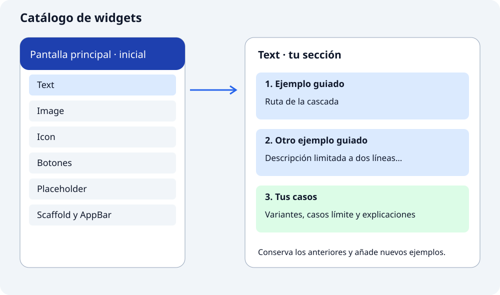

## De qué proyecto partimos

Crearemos **`catalogo_widgets`** con una pantalla principal y un listado de familias de widgets. En este apartado tienes el código inicial completo: copiarás la base y prepararás una pantalla vacía para cada familia. Después las completarás durante los tutoriales.

Tu tarea será convertir esas secciones vacías en un **catálogo de ejemplos ejecutables**. No tendrás que construir el menú ni programar el paso entre pantallas. Ese mecanismo ya viene preparado y lo estudiaremos cuando trabajemos navegación. Por ahora céntrate en el contenido de cada sección.

## Así será el catálogo



La izquierda representa la pantalla que pondrás en marcha con el código de este apartado. La derecha muestra el trabajo que irás completando. Cada familia tendrá su propia sección con ejemplos guiados y, al final, los casos que añadas tú. La flecha solo relaciona la entrada del listado con su sección; no necesitamos estudiar su implementación todavía.

Cada demostración incluirá un título identificable, el widget real y una explicación breve del cambio que queremos observar. Por ejemplo, en `Text` compararemos un título con estilo, una descripción limitada a dos líneas y una frase con varios estilos. Después añadirás casos nuevos como parte de la actividad.

## 1. Crea y abre el proyecto

En la carpeta donde guardas tus prácticas, ejecuta estas órdenes una a una. Si ya tienes `catalogo_widgets` de los apartados anteriores, consérvalo y continúa con el paso 2; no lo crees de nuevo.

```bash
flutter create catalogo_widgets
cd catalogo_widgets
flutter pub get
```

Abre en VS Code la carpeta que contiene `pubspec.yaml`. Conserva las instrucciones y skills que ya has preparado.

### 📁 Estructura de carpetas del catálogo

Organizaremos la interfaz bajo **`lib/ui/`**, agrupada por funcionalidad, y las piezas visuales compartidas en **`lib/ui/core/ui/`**. Seguimos la organización del [caso práctico de arquitectura de Flutter](https://docs.flutter.dev/app-architecture/case-study). En este curso llamaremos también `ui` a la subcarpeta visual de cada funcionalidad, en lugar de `widgets`, para mantener una única convención.

Este será el árbol al completar las primeras actividades. Los componentes y sus pruebas se añadirán cuando los implementemos:

```text
catalogo_widgets/
├── lib/
│   ├── main.dart
│   └── ui/
│       ├── core/
│       │   └── ui/
│       │       └── etiqueta_catalogo.dart
│       └── catalogo/
│           └── ui/
│               ├── catalogo_pantalla.dart
│               ├── text_ejemplos_pantalla.dart
│               ├── image_ejemplos_pantalla.dart
│               ├── icon_ejemplos_pantalla.dart
│               ├── botones_ejemplos_pantalla.dart
│               ├── placeholder_ejemplos_pantalla.dart
│               └── scaffold_ejemplos_pantalla.dart
├── test/
│   ├── widget_test.dart
│   └── ui/
│       └── core/
│           └── ui/
│               └── etiqueta_catalogo_test.dart
├── assets/
│   └── images/                 Al trabajar imágenes locales
├── .agents/
│   ├── instrucciones.md
│   └── skills/
├── android/, ios/, web/, ...    Configuración de plataformas
└── pubspec.yaml
```

| Lugar | Responsabilidad | Ejemplo |
| --- | --- | --- |
| `lib/main.dart` | Arrancar y configurar la aplicación. Importa la pantalla principal. | Llamar a `runApp`. |
| `lib/ui/catalogo/ui/` | Contener las pantallas y las piezas visuales específicas del catálogo. | Mostrar las variantes de una etiqueta. |
| `lib/ui/core/ui/` | Contener componentes visuales reutilizables por distintas pantallas o funcionalidades. | Definir `EtiquetaCatalogo` y sus parámetros. |
| `test/ui/` | Probar la interfaz, reflejando sus rutas dentro de `lib/ui/`. | Comprobar contenido y variantes de un componente aislado. |
| `assets/images/` | Guardar imágenes locales, declaradas en `pubspec.yaml`. | Una fotografía del proyecto. |
| `.agents/` | Guardar las instrucciones del asistente, fuera del código de la aplicación. | Reglas de código y procedimientos de revisión. |
| Carpetas de plataforma y `pubspec.yaml` | Configurar destinos, dependencias y recursos. | Registrar imágenes o configurar Android. |

**Toda pieza visual se guarda en una carpeta llamada `ui`**: si pertenece solo a una funcionalidad, en `lib/ui/<funcionalidad>/ui/`; si es compartida, en `lib/ui/core/ui/`. Por ejemplo, el primer proyecto utiliza `lib/ui/entrenamiento/ui/`. El nombre de una funcionalidad expresa qué parte de la aplicación agrupa, no otro nombre para la capa visual.

Crea ahora la ruta del catálogo en el paso 2. La ruta compartida, sus pruebas y las imágenes se incorporarán según las actividades. Los archivos usan `snake_case`, como `etiqueta_catalogo.dart`, y las clases, `UpperCamelCase`, como `EtiquetaCatalogo`.

### 🧭 Qué añadiremos cuando aparezcan otras responsabilidades

La interfaz se organiza por funcionalidad; los datos se agrupan por su responsabilidad. Mantendremos las rutas visuales desde el inicio y ampliaremos la estructura cuando sea necesario:

```text
lib/
├── main.dart
├── ui/
│   ├── core/
│   │   ├── ui/                  Componentes compartidos
│   │   └── themes/              Configuración visual compartida, más adelante
│   └── favoritos/
│       ├── ui/
│       │   └── favoritos_screen.dart
│       └── view_models/
│           └── favoritos_view_model.dart
├── domain/
│   └── models/                  Tipos de datos de la aplicación
└── data/
    ├── repositories/            Gestión de datos
    ├── services/                Acceso a API, archivos u otros orígenes
    └── model/                   Modelos de una API, si hacen falta
```

Este segundo árbol es una previsión: todavía no debes crear esas clases. Una vista muestra datos y comunica acciones; un ViewModel mantiene el estado de presentación; un repositorio gestiona datos y un servicio accede a su origen. Los modelos de dominio representan los datos usados por la aplicación; no implican por sí solos añadir una capa de casos de uso. Consulta la [guía de arquitectura de Flutter](https://docs.flutter.dev/app-architecture/guide).

Por ahora separaremos la pantalla de sus componentes reutilizables. Decidir el tamaño de una etiqueta es una responsabilidad visual; guardar favoritos no lo es. Las dependencias se recibirán desde fuera para poder sustituirlas en pruebas. Añadiremos ViewModels y repositorios cuando trabajemos estado y persistencia, manteniendo las carpetas `ui` para todas las piezas visuales.

## 2. Prepara las pantallas vacías

Crea `lib/ui/catalogo/ui/` y los seis archivos de la tabla. Copia la siguiente plantilla en cada uno: cambia **las dos apariciones del nombre de clase** y el título de `AppBar` según la fila. No cambies el resto.

| Archivo dentro de `lib/ui/catalogo/ui/` | Clase y constructor | Título |
| --- | --- | --- |
| `text_ejemplos_pantalla.dart` | `TextEjemplosPantalla` | `Ejemplos de Text` |
| `image_ejemplos_pantalla.dart` | `ImageEjemplosPantalla` | `Ejemplos de Image` |
| `icon_ejemplos_pantalla.dart` | `IconEjemplosPantalla` | `Ejemplos de Icon` |
| `botones_ejemplos_pantalla.dart` | `BotonesEjemplosPantalla` | `Ejemplos de Botones` |
| `placeholder_ejemplos_pantalla.dart` | `PlaceholderEjemplosPantalla` | `Ejemplos de Placeholder` |
| `scaffold_ejemplos_pantalla.dart` | `ScaffoldEjemplosPantalla` | `Ejemplos de Scaffold y AppBar` |

```dart
import 'package:flutter/material.dart';

class TextEjemplosPantalla extends StatelessWidget {
  const TextEjemplosPantalla({super.key});

  @override
  Widget build(BuildContext context) {
    return Scaffold(
      appBar: AppBar(title: const Text('Ejemplos de Text')),
      body: ListView(
        padding: const EdgeInsets.all(16),
        children: [
          // Aquí añadiremos los ejemplos del tutorial.
        ],
      ),
    );
  }
}
```

`children` queda vacío a propósito: ahí añadirás los ejemplos. `ListView` es el soporte para colocarlos en vertical y poder desplazarte si no caben. Cada tutorial indicará qué archivo modificar.

## 3. Completa el listado y el punto de entrada

Crea `lib/ui/catalogo/ui/catalogo_pantalla.dart` con este contenido completo. Las seis pantallas del paso anterior están en la misma carpeta; por eso los imports solo indican el nombre del archivo. El mecanismo entre pantallas ya está resuelto y lo estudiaremos más adelante:

```dart
import 'package:flutter/material.dart';

import 'text_ejemplos_pantalla.dart';
import 'image_ejemplos_pantalla.dart';
import 'icon_ejemplos_pantalla.dart';
import 'botones_ejemplos_pantalla.dart';
import 'placeholder_ejemplos_pantalla.dart';
import 'scaffold_ejemplos_pantalla.dart';

class CatalogoPantalla extends StatelessWidget {
  const CatalogoPantalla({super.key});

  @override
  Widget build(BuildContext context) {
    return Scaffold(
      appBar: AppBar(title: const Text('Catálogo de widgets')),
      body: ListView(
        children: [
          ListTile(
            leading: const Icon(Icons.text_fields),
            title: const Text('Text'),
            trailing: const Icon(Icons.chevron_right),
            onTap: () {
              Navigator.of(context).push(
                MaterialPageRoute<void>(
                  builder: (context) => const TextEjemplosPantalla(),
                ),
              );
            },
          ),
          ListTile(
            leading: const Icon(Icons.image_outlined),
            title: const Text('Image'),
            trailing: const Icon(Icons.chevron_right),
            onTap: () {
              Navigator.of(context).push(
                MaterialPageRoute<void>(
                  builder: (context) => const ImageEjemplosPantalla(),
                ),
              );
            },
          ),
          ListTile(
            leading: const Icon(Icons.star_outline),
            title: const Text('Icon'),
            trailing: const Icon(Icons.chevron_right),
            onTap: () {
              Navigator.of(context).push(
                MaterialPageRoute<void>(
                  builder: (context) => const IconEjemplosPantalla(),
                ),
              );
            },
          ),
          ListTile(
            leading: const Icon(Icons.smart_button_outlined),
            title: const Text('Botones'),
            trailing: const Icon(Icons.chevron_right),
            onTap: () {
              Navigator.of(context).push(
                MaterialPageRoute<void>(
                  builder: (context) => const BotonesEjemplosPantalla(),
                ),
              );
            },
          ),
          ListTile(
            leading: const Icon(Icons.crop_square),
            title: const Text('Placeholder'),
            trailing: const Icon(Icons.chevron_right),
            onTap: () {
              Navigator.of(context).push(
                MaterialPageRoute<void>(
                  builder: (context) => const PlaceholderEjemplosPantalla(),
                ),
              );
            },
          ),
          ListTile(
            leading: const Icon(Icons.web_asset),
            title: const Text('Scaffold y AppBar'),
            trailing: const Icon(Icons.chevron_right),
            onTap: () {
              Navigator.of(context).push(
                MaterialPageRoute<void>(
                  builder: (context) => const ScaffoldEjemplosPantalla(),
                ),
              );
            },
          ),
        ],
      ),
    );
  }
}
```

Ahora sustituye `lib/main.dart` por el código de arranque. Importa el listado desde `ui` y configura la aplicación:

```dart
import 'package:flutter/material.dart';

import 'ui/catalogo/ui/catalogo_pantalla.dart';

void main() => runApp(const CatalogoApp());

class CatalogoApp extends StatelessWidget {
  const CatalogoApp({super.key});

  @override
  Widget build(BuildContext context) {
    return const MaterialApp(
      debugShowCheckedModeBanner: false,
      title: 'Catálogo de widgets',
      home: CatalogoPantalla(),
    );
  }
}
```

## 4. Comprueba el punto de partida

Guarda los ocho archivos y ejecuta desde la raíz del proyecto:

```bash
dart format lib
flutter run
```

`dart format lib` aplica el formato estándar de Dart a todos los archivos `.dart` de la carpeta `lib` y sus subcarpetas. Ajusta la indentación, los espacios y los saltos de línea, y guarda los cambios en esos archivos. No ejecuta la aplicación ni comprueba su comportamiento. Después, `flutter run` inicia la aplicación para revisar el resultado en pantalla.

Debes ver las seis entradas. Abre cada una y comprueba su título y el cuerpo vacío; vuelve al listado con el control de la barra. Si falla un import, revisa que el nombre del archivo y el de la clase coincidan con la tabla.

Para comprobar este punto de partida, puedes pedir a `test-widget` que prepare `test/widget_test.dart` y verifique que `CatalogoApp` muestra el título y las seis etiquetas. Ejecuta `flutter analyze` para detectar problemas en el código y `flutter test` para ejecutar las pruebas, sin estudiar todavía el mecanismo entre pantallas.

## 5. 🤖 Avanza en el catálogo con el asistente

El asistente que has configurado puede ayudarte durante cada actividad: comprender una propiedad, implementar una pieza con los estándares del proyecto, localizar un error o comprobar sus variantes. **Trabaja sobre un componente y un objetivo cada vez**, conservando los ejemplos que ya funcionan.

### Prepara el contexto de la tarea

Utiliza las [instrucciones del proyecto](../configurar-el-asistente/) y las [skills que has creado](../crear-skills/). Si trabajas en un chat, adjunta `.agents/instrucciones.md`, el `SKILL.md` correspondiente y los archivos de la tarea. Si tu editor descubre las skills, pídela por su nombre e indica qué archivos debe consultar. No des por hecho que el asistente conoce lo que has cambiado en otra sesión.

Antes de pedir ayuda, escribe cuatro datos: **qué quieres conseguir, qué archivo estás modificando, qué has intentado y qué debería ocurrir**. Por ejemplo:

```text
Estoy trabajando en el catálogo de widgets y sigo .agents/instrucciones.md.
Estoy en el apartado Variantes de un componente.
Archivo: lib/ui/core/ui/etiqueta_catalogo.dart.
Quiero mostrar el mismo texto como etiqueta normal o destacada.
Ya he escrito la clase y el constructor; me falta elegir el estilo.
Conozco clases, parámetros nombrados y StatelessWidget.
```

### Elige la skill según lo que necesites

| Situación | Skill | Resultado que debes pedir |
| --- | --- | --- |
| No entiendes una propiedad o una expresión. | `explain-widget` | Explicación del fragmento y un ejemplo pequeño. |
| Quieres implementar o extraer un componente con requisitos definidos. | `create-component` | Un componente en su archivo de `ui`, con parámetros y una integración limitada al catálogo. |
| El resultado no coincide con lo esperado. | `give-hints` | Una primera pista a partir del código, el error y tu intento. |
| Quieres revisar lo que has escrito. | `review-code` | Problemas concretos, su causa y cómo comprobarlos, sin modificar archivos. |
| Necesitas comprobar un comportamiento. | `test-widget` | Casos derivados de requisitos y pruebas que puedan detectar fallos reales. |

No hace falta usar las cinco en cada tarea. Si necesitas comprender `destacada ? 22 : 16`, pide a `explain-widget` que explique esa expresión antes de solicitar una implementación. Si estás resolviendo la actividad por tu cuenta, utiliza `give-hints` cuando te bloquees.

### Pasa de una idea a un cambio concreto

Escribe primero los requisitos del componente. Así podrás valorar el resultado en lugar de aceptar cualquier propuesta que compile. Cuando la tarea sea implementar o adaptar código, una petición acotada sería:

```text
Utiliza create-component y las instrucciones del proyecto.
Revisa mi intento de EtiquetaCatalogo en el archivo que adjunto y complétalo.
Requisitos:
- texto es obligatorio; destacada vale false por defecto.
- La variante normal usa tamaño 16 y peso normal.
- La destacada usa tamaño 22 y negrita.
- Ambas muestran exactamente el texto recibido.
Conserva el componente en lib/ui/core/ui/etiqueta_catalogo.dart.
En lib/ui/catalogo/ui/text_ejemplos_pantalla.dart muestra las dos variantes
sin borrar los ejemplos existentes. No cambies el listado ni main.dart.
Explica los cambios y señala qué debo comprobar al ejecutarlos.
```

Si solo quieres orientación, cambia la petición por: «Utiliza `give-hints`. Con mi código actual ocurre esto: […]; esperaba esto: […]. He probado […]. Dame una pista y espera mi intento; no modifiques archivos». Adjunta el error exacto si lo hay.

Después de cada cambio, abre la sección del catálogo y comprueba el resultado. Antes de pedir a `review-code` que revise los archivos, escribe tú por qué has elegido esos parámetros y qué hace cada variante. Contrasta tu explicación con la revisión.

### Pide pruebas de los requisitos, no solo del código

Proporciona a `test-widget` la implementación actual y los requisitos que escribiste. Por ejemplo, una vez aceptado el componente anterior:

```text
Utiliza test-widget. Adjunto EtiquetaCatalogo y sus requisitos.
Crea test/ui/core/ui/etiqueta_catalogo_test.dart con los imports reales.
Comprueba el texto recibido, la variante normal al omitir destacada,
y los tamaños y pesos de ambas variantes. Comprueba también que cambiar
el texto desde el padre actualiza el contenido mostrado.
Presenta los casos y explica qué fallo detectaría cada uno.
No cambies el componente para alterar sus requisitos.
Ejecuta las pruebas si puedes y distingue el resultado real de lo no comprobado.
```

Ejecuta desde la raíz `dart format lib test`, `flutter analyze` y `flutter test`. El primero ajusta el formato; el segundo detecta problemas de código; el tercero ejecuta las pruebas. Si el asistente afirma haberlos ejecutado, revisa la salida. Si no dispone de terminal, ejecútalos tú y aporta el resultado al pedir otra ayuda. Las pruebas de propiedades no sustituyen a revisar visualmente el catálogo.

### Conserva lo aprendido

Al terminar, anota qué componente añadiste, qué parámetros seleccionan sus variantes y qué has comprobado. Actualiza el contexto del asistente al avanzar de apartado. Debes poder explicar el componente sin leer el chat: para qué sirve, dónde decide su aspecto y cómo se utiliza desde la pantalla.

## Cómo avanzaremos en cada apartado

1. Comprende para qué sirve el widget y prueba su ejemplo mínimo.
2. Estudia sus propiedades principales y los ejemplos; identifica también los widgets auxiliares que utilizan.
3. Implementa los componentes propuestos en archivos propios de `lib/ui/core/ui/`, con variantes seleccionadas mediante parámetros.
4. Impórtalos desde la pantalla correspondiente y muestra varias configuraciones de cada uno en el catálogo.
5. Comprueba los requisitos y utiliza las skills para revisar código y generar pruebas concretas.

La pantalla es el lugar donde mostramos los casos; el componente es la pieza reutilizable que recibe datos. No necesitas modificar el listado principal. Empieza por [Variantes de un componente](../../basicos/estilo-y-variantes/), donde prepararemos una primera pieza reutilizable antes de estudiar cada widget básico.
