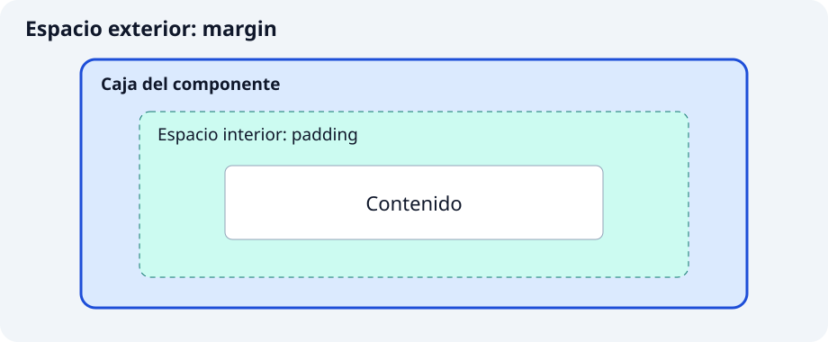

**`Container` reúne tamaño, espacio y decoración alrededor de un hijo.** Es útil para construir una caja de información o destacar una zona. Si solo necesitas separar elementos o limitar dimensiones, `SizedBox` y `Padding` expresan esa intención con menos opciones.

```dart
Container(color: Colors.teal.shade50, child: const Text('Próxima salida'))
```

`Text` es el hijo que muestra el contenido. La caja recibe las restricciones de su padre: indicar un tamaño no significa que siempre pueda imponerlo.



## 🔧 Propiedades principales

### 1. `width` y `height`: reservar una zona

Son útiles para comparar piezas con dimensiones conocidas. El tamaño debe caber dentro de los límites que recibe el componente.

```dart
Center(
  child: Container(
    width: 240,
    height: 100,
    color: Colors.teal.shade50,
    child: const Text('Zona reservada'),
  ),
)
```

`Center` centra la caja y permite que no ocupe forzosamente todo el ancho de la lista. Dentro de un padre que exige un tamaño exacto, un `SizedBox` pequeño no puede ignorar esa exigencia.

### 2. `padding` y `margin`: espacio interior y exterior

`padding` separa el contenido del borde; `margin` separa la caja de lo que la rodea. Son útiles para que un mensaje respire sin confundir el tamaño de la caja con su separación exterior.

```dart
Container(
  margin: const EdgeInsets.symmetric(vertical: 12),
  padding: const EdgeInsets.all(16),
  color: Colors.teal.shade50,
  child: const Text('Salida a las 9:00'),
)
```

`EdgeInsets` describe medidas, no dibuja un widget. `all` aplica el mismo valor en los cuatro lados; `symmetric` separa horizontal y vertical; `only(left: 8)` configura un lado. `EdgeInsetsDirectional.only(start: 8)` respeta la dirección de lectura.

### 3. `decoration`: fondo, borde y sombra

Permite que varias señales visuales pertenezcan a una misma caja. Es útil para tarjetas informativas o avisos con borde.

```dart
Container(
  padding: const EdgeInsets.all(16),
  decoration: BoxDecoration(
    color: Colors.amber.shade50,
    border: Border.all(color: Colors.amber.shade800, width: 2),
    borderRadius: BorderRadius.circular(12),
    boxShadow: const [
      BoxShadow(color: Colors.black12, blurRadius: 6, offset: Offset(0, 3)),
    ],
  ),
  child: const Text('Lleva agua suficiente'),
)
```

`BoxDecoration`, `Border`, `BorderRadius` y `BoxShadow` son objetos de configuración. `Offset` indica el desplazamiento de la sombra. Cuando uses `decoration`, pon el color dentro de ella: no combines `Container.color` y `Container.decoration`. Redondear la decoración no recorta automáticamente al hijo.

### 4. `alignment`, Center y Align: colocar un hijo

La alineación interesa cuando la caja dispone de más espacio que el contenido. `Center` elige el centro y `Align` permite otras posiciones.

```dart
const SizedBox(
  height: 100,
  child: Align(
    alignment: Alignment.centerRight,
    child: Icon(Icons.hiking, size: 40),
  ),
)
```

`SizedBox` reserva altura, `Align` coloca su hijo y `Icon` dibuja un símbolo. También puedes usar `Container(alignment: Alignment.center, ...)` si ya necesitas otras opciones de esa caja.

### 5. SizedBox y Padding: una sola responsabilidad

`SizedBox` sirve para reservar dimensiones o un hueco; `Padding` añade espacio interior a cualquier hijo. No necesitas decorar una caja si solo quieres separar elementos.

```dart
const Padding(
  padding: EdgeInsets.all(12),
  child: SizedBox(
    height: 60,
    child: Center(child: Text('Punto de encuentro')),
  ),
)
```

`Padding` no añade color ni margen exterior. Un `SizedBox(height: 16)` sin hijo puede actuar como hueco entre dos ejemplos.

## ✍️ Actividad: crea componentes con variantes

Implementa los dos componentes en archivos de `lib/ui/core/ui/`. Cada clase recibe la configuración mediante parámetros con nombre y campos `final`; utiliza `StatelessWidget` y constructor `const` cuando sea posible. Los parámetros sin valor predeterminado son obligatorios (`required`), aunque admitan `null`. Las variantes deciden la presentación sin duplicar la clase.

### 1. `PanelAviso`

`lib/ui/core/ui/panel_aviso.dart`

Parámetros: `String mensaje`, `bool importante = false`, `bool compacto = false`.

Decide fondo y borde según la importancia; decide el espacio interior según el modo compacto. El mensaje no cambia. Muestra las cuatro combinaciones.

### 2. `ZonaAlineada`

`lib/ui/core/ui/zona_alineada.dart`

Parámetros: `Widget contenido`, `bool alFinal = false`, `double alto = 100`.

Reserva una altura positiva y coloca el contenido al inicio o al final usando `AlignmentDirectional`. No modifiques el hijo recibido.

## 🧩 Muestra las variantes en el catálogo

En `lib/ui/catalogo/ui/contenedores_ejemplos_pantalla.dart`, importa los archivos de los componentes al principio:

```dart
import 'package:catalogo_widgets/ui/core/ui/panel_aviso.dart';
import 'package:catalogo_widgets/ui/core/ui/zona_alineada.dart';
```

Después de implementarlos, estos usos pueden formar parte de la lista de ejemplos:

```dart
const PanelAviso(mensaje: 'Lleva agua'),
const PanelAviso(mensaje: 'Lleva agua', importante: true, compacto: true),
const ZonaAlineada(contenido: Icon(Icons.hiking), alFinal: true),
```

Prueba un mensaje largo y un ancho reducido. Explica qué cambio afecta al interior y cuál al exterior. Comprueba que el componente nunca combina `color` y `decoration` en el mismo `Container`.

Completa las variantes que falten con títulos y explicaciones propias. Utiliza `create-component` para revisar tu intento y `test-widget` para comprobar requisitos concretos. Ejecuta `dart format lib test`, `flutter analyze` y las pruebas. Revisa también el resultado visual: una prueba superada no garantiza que el texto se lea bien.

Referencias: [Container](https://api.flutter.dev/flutter/widgets/Container-class.html) · [SizedBox](https://api.flutter.dev/flutter/widgets/SizedBox-class.html) · [Padding](https://api.flutter.dev/flutter/widgets/Padding-class.html).
