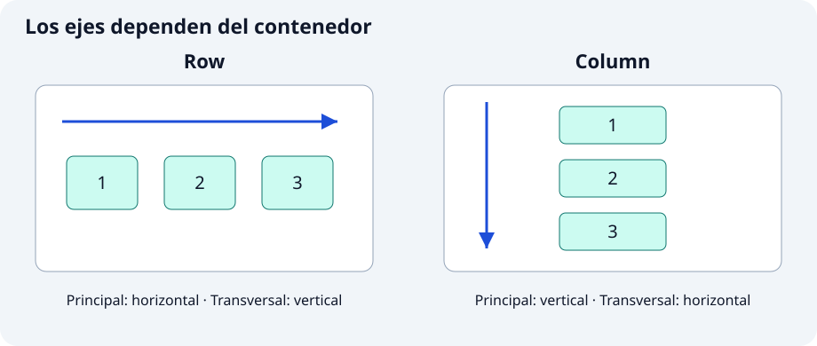

**`Row` coloca hijos en horizontal y `Column`, en vertical.** Son útiles para componer una ficha con iconos, textos y acciones. Ninguno añade desplazamiento ni cambia automáticamente a otra línea: para saltar de línea utilizaremos `Wrap`.

```dart
const Row(children: [Icon(Icons.hiking), Text('Ruta del río')])
```

`children` es una lista de widgets. `Icon` aporta el símbolo y `Text`, la etiqueta. En una columna, el mismo conjunto se apilaría en vertical.



## 🔧 Propiedades principales

### 1. Eje principal, `mainAxisAlignment` y `mainAxisSize`

En `Row` el eje principal es horizontal; en `Column` es vertical. La alineación principal reparte el espacio sobrante: es útil para separar acciones sin medir a mano cada hueco.

```dart
const SizedBox(
  height: 120,
  child: Column(
    mainAxisAlignment: MainAxisAlignment.spaceEvenly,
    children: [Text('Inicio'), Text('Mirador'), Text('Llegada')],
  ),
)
```

`SizedBox` aporta una altura finita en la que hay espacio que repartir. `start`, `center`, `end` y `spaceBetween` son otras opciones. `mainAxisSize: MainAxisSize.min` reduce la extensión principal al contenido; con menos espacio sobrante, la distribución puede dejar de apreciarse.

### 2. `crossAxisAlignment`: alinear en el otro eje

Permite alinear textos y símbolos de tamaños diferentes. El eje transversal es vertical en una fila y horizontal en una columna.

```dart
const Row(
  crossAxisAlignment: CrossAxisAlignment.start,
  children: [
    Icon(Icons.terrain, size: 56),
    SizedBox(width: 12),
    Text('Nivel fácil'),
  ],
)
```

`start` alinea arriba en esta fila y `center` centraría verticalmente. `SizedBox` reserva el hueco horizontal. En una columna puedes utilizar `stretch` para que los hijos ocupen el ancho disponible, siempre que ese ancho esté limitado.

### 3. Expanded y `flex`: asignar el espacio restante

`Expanded` obliga a su hijo a ocupar la parte asignada del espacio restante. Es útil para que un texto largo no expulse el icono de una fila, o para repartir paneles proporcionalmente.

```dart
const Row(
  children: [
    Expanded(
      flex: 2,
      child: Text('Un nombre de ruta largo', maxLines: 1, overflow: TextOverflow.ellipsis),
    ),
    SizedBox(width: 12),
    Expanded(flex: 1, child: Text('8 km')),
  ],
)
```

Después del hueco fijo, el espacio flexible se reparte 2:1. `flex` expresa proporciones, no píxeles. `Expanded` debe pertenecer a un `Row`, `Column` o `Flex`; no lo coloques directamente en el `ListView`. En una columna dentro de un desplazamiento vertical necesitas limitar antes su altura.

### 4. Flexible y Spacer: dejar libertad o reservar hueco

`Flexible` con `FlexFit.loose` permite ocupar menos del espacio asignado; `Spacer` ocupa espacio flexible sin contenido. Son útiles para etiquetas cortas y barras con acciones en extremos.

```dart
const Row(
  children: [
    Flexible(fit: FlexFit.loose, child: Text('Inicio')),
    Spacer(flex: 2),
    Icon(Icons.flag),
  ],
)
```

El texto no tiene que rellenar toda su asignación. El hueco absorbe espacio sobrante. Si usas `Spacer`, no esperes que `spaceBetween` reparta también ese mismo espacio. Se aplican las mismas condiciones de eje acotado que con `Expanded`.

### 5. Wrap: `spacing`, `runSpacing` y `alignment`

`Wrap` pasa los elementos a otra línea cuando no caben. Es útil para etiquetas cuyo número o longitud cambia y evita forzar una fila que desborda.

```dart
const Wrap(
  spacing: 8,
  runSpacing: 12,
  alignment: WrapAlignment.start,
  children: [
    Chip(label: Text('Bosque')),
    Chip(label: Text('Río')),
    Chip(label: Text('Mirador')),
    Chip(label: Text('Ruta circular')),
  ],
)
```

`Chip` es una etiqueta Material compacta y su `label` recibe el texto; aquí no es seleccionable. `spacing` separa vecinos de una línea y `runSpacing` separa líneas. Reduce el ancho para observar el salto.

## ✍️ Actividad: crea componentes con variantes

Implementa los dos componentes en archivos de `lib/ui/core/ui/`. Cada clase recibe la configuración mediante parámetros con nombre y campos `final`; utiliza `StatelessWidget` y constructor `const` cuando sea posible. Los parámetros sin valor predeterminado son obligatorios (`required`), aunque admitan `null`. Las variantes deciden la presentación sin duplicar la clase.

### 1. `FichaRecorrido`

`lib/ui/core/ui/ficha_recorrido.dart`

Parámetros: `String nombre`, `String distancia`, `bool vertical = false`.

Organiza nombre y distancia en fila o columna. En horizontal, limita el texto para que una descripción larga no desborde. Conserva el mismo contenido.

### 2. `GrupoEtiquetas`

`lib/ui/core/ui/grupo_etiquetas.dart`

Parámetros: `List<String> etiquetas`, `bool compacto = false`, `bool centrado = false`.

Usa `Wrap` con separaciones distintas según el modo. Cada dato produce un `Chip`; una lista vacía no debe causar errores.

## 🧩 Muestra las variantes en el catálogo

En `lib/ui/catalogo/ui/contenedores_ejemplos_pantalla.dart`, importa los archivos de los componentes al principio:

```dart
import 'package:catalogo_widgets/ui/core/ui/ficha_recorrido.dart';
import 'package:catalogo_widgets/ui/core/ui/grupo_etiquetas.dart';
```

Después de implementarlos, estos usos pueden formar parte de la lista de ejemplos:

```dart
const FichaRecorrido(nombre: 'Ruta del río', distancia: '8 km'),
const FichaRecorrido(nombre: 'Ruta del río', distancia: '8 km', vertical: true),
const GrupoEtiquetas(etiquetas: ['Bosque', 'Río', 'Mirador'], compacto: true),
```

Compara las dos orientaciones a 280 y 600 píxeles de ancho. Añade varias etiquetas largas y comprueba que aparecen en líneas nuevas sin franjas de desbordamiento.

Completa las variantes que falten con títulos y explicaciones propias. Utiliza `create-component` para revisar tu intento y `test-widget` para comprobar requisitos concretos. Ejecuta `dart format lib test`, `flutter analyze` y las pruebas. Revisa también el resultado visual: una prueba superada no garantiza que el texto se lea bien.

Referencias: [Row](https://api.flutter.dev/flutter/widgets/Row-class.html) · [Column](https://api.flutter.dev/flutter/widgets/Column-class.html) · [Flexible](https://api.flutter.dev/flutter/widgets/Flexible-class.html) · [Wrap](https://api.flutter.dev/flutter/widgets/Wrap-class.html).
