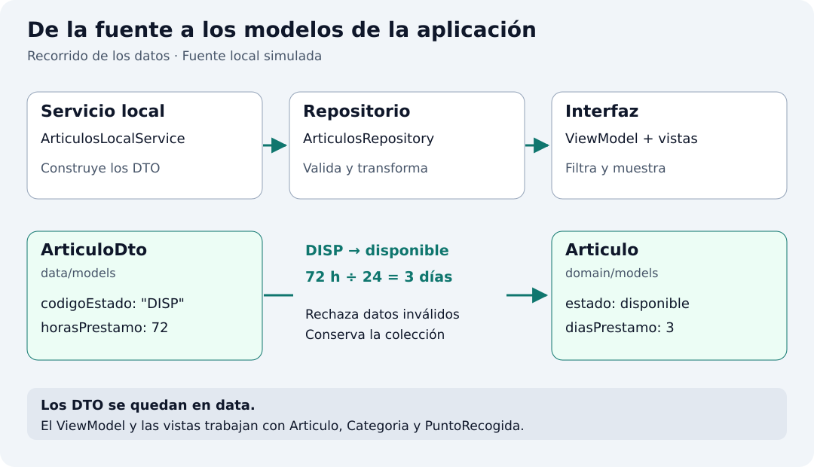

## Para qué sirve la capa de datos

Esta capa permite que la interfaz consulte artículos sin conocer cómo se obtienen. Repartiremos el trabajo entre un servicio que conoce la fuente y un repositorio que ofrece los datos con las garantías que necesita la aplicación. El ViewModel consultará el repositorio; no tendrá que construir artículos ni validar sus identificadores.



### Servicio: acceder al origen

`ArticulosLocalService` reúne los datos ficticios y devuelve modelos de la fuente (`ArticuloDto`). No decide qué artículos debe mostrar el filtro ni qué pantalla se abre. Si después utilizamos un archivo o una API, el acceso a ese origen se resolverá aquí y se adaptará el repositorio para consumirlo; las tarjetas podrán seguir recibiendo `Articulo`.

### Repositorio: ofrecer una colección válida

`ArticulosRepository` es el punto de consulta de los artículos para el ViewModel. En este ejemplo lee el servicio una vez, rechaza identificadores duplicados, transforma los DTO en modelos de dominio y conserva la colección inmutable. Así, cualquier consumidor recibe datos con las mismas garantías. La disponibilidad es un dato del artículo; elegir mostrar solo disponibles es una decisión de presentación que resolverá el ViewModel.

El servicio conoce el origen: en este caso construye los datos en Dart. El repositorio ofrece esos datos al resto de la aplicación y comprueba una regla: cada artículo debe tener un identificador distinto.

La lectura es inmediata y síncrona. No necesitamos `Future`, esperas artificiales ni indicadores de carga para datos que ya están en memoria. El repositorio carga una vez al construirse y conserva una colección de solo lectura.

## Modelos de la fuente: el contrato de entrada

Un DTO (*Data Transfer Object*) representa la estructura que entrega una fuente. En `data/models` respetamos ese contrato; en `domain/models` definimos lo que necesita la aplicación. Ninguno importa Flutter. Los DTO solo circulan entre servicio y repositorio; el ViewModel y las vistas reciben modelos de dominio.

Simularemos una fuente local que entrega el estado como código (`DISP`, `PREST`, `MANT`) y el plazo en horas. La aplicación trabaja con `EstadoArticulo` y días completos. Por ejemplo, el taladro llega con `DISP` y `72`, y el repositorio lo convierte en `EstadoArticulo.disponible` y `3` días. Así la diferencia entre ambos modelos tiene una utilidad concreta.

| Fuente: `ArticuloDto` | Aplicación: `Articulo` |
| --- | --- |
| `codigoEstado`: código de texto del proveedor. | `estado`: valor de `EstadoArticulo`. |
| `horasPrestamo`: plazo en horas. | `diasPrestamo`: plazo en días completos. |
| `CategoriaDto` y `PuntoRecogidaDto`: objetos de la fuente. | `Categoria` y `PuntoRecogida`: objetos del dominio. |

Los agrupamos en un archivo para este ejemplo pequeño. Los DTO tienen campos `final` y constructores `const`, pero no heredan de los modelos de dominio: pueden evolucionar de forma independiente. Si la fuente cambia sus códigos, adaptaremos la conversión sin cambiar el filtro o el detalle.

## 1. Crea los modelos de la fuente

`lib/data/models/articulo_dto.dart`

```dart
class CategoriaDto {
  const CategoriaDto({required this.id, required this.nombre, required this.siglas});
  final String id;
  final String nombre;
  final String siglas;
}

class PuntoRecogidaDto {
  const PuntoRecogidaDto({
    required this.id,
    required this.nombre,
    required this.direccion,
    required this.horario,
  });
  final String id;
  final String nombre;
  final String direccion;
  final String horario;
}

class ArticuloDto {
  const ArticuloDto({
    required this.id,
    required this.nombre,
    required this.descripcion,
    required this.categoria,
    required this.puntoRecogida,
    required this.codigoEstado,
    required this.horasPrestamo,
    required this.recomendaciones,
  });
  final String id;
  final String nombre;
  final String descripcion;
  final CategoriaDto categoria;
  final PuntoRecogidaDto puntoRecogida;
  final String codigoEstado;
  final int horasPrestamo;
  final String recomendaciones;
}
```

La fuente se simula con objetos Dart, sin leer JSON ni consultar una API. Por eso no necesitamos `fromJson` todavía. Cuando incorporemos JSON, el servicio lo decodificará a DTO y el repositorio seguirá entregando modelos de dominio. La separación es útil cuando los formatos difieren; no exige duplicar cada clase en todas las aplicaciones.

## 2. Crea el servicio local


`lib/data/services/articulos_local_service.dart`

```dart
import '../models/articulo_dto.dart';

class ArticulosLocalService {
  const ArticulosLocalService();

  List<ArticuloDto> leer() {
    const bricolaje = CategoriaDto(id: 'c1', nombre: 'Bricolaje', siglas: 'BR');
    const hogar = CategoriaDto(id: 'c2', nombre: 'Hogar', siglas: 'HO');
    const ocio = CategoriaDto(id: 'c3', nombre: 'Ocio', siglas: 'OC');
    const centro = PuntoRecogidaDto(
      id: 'p1', nombre: 'Centro vecinal La Plaza',
      direccion: 'Calle Mayor, 12', horario: 'Lunes a viernes, de 17 a 20 h',
    );
    const biblioteca = PuntoRecogidaDto(
      id: 'p2', nombre: 'Biblioteca del Parque',
      direccion: 'Avenida del Parque, 8', horario: 'Sábados, de 10 a 13 h',
    );
    return const [
      ArticuloDto(
        id: 'a1', nombre: 'Taladro percutor',
        descripcion: 'Taladro con maletín y juego de brocas para pequeñas reparaciones.',
        categoria: bricolaje, puntoRecogida: centro,
        codigoEstado: 'DISP', horasPrestamo: 72,
        recomendaciones: 'Usar gafas de protección y devolver las brocas en su estuche.',
      ),
      ArticuloDto(
        id: 'a2', nombre: 'Máquina de coser',
        descripcion: 'Máquina portátil para arreglos de ropa y proyectos sencillos.',
        categoria: hogar, puntoRecogida: centro,
        codigoEstado: 'PREST', horasPrestamo: 168,
        recomendaciones: 'Incluye pedal y manual. Devolver sin hilos en la bobina.',
      ),
      ArticuloDto(
        id: 'a3', nombre: 'Proyector',
        descripcion: 'Proyector con conexión HDMI para una sesión de cine en grupo.',
        categoria: ocio, puntoRecogida: biblioteca,
        codigoEstado: 'DISP', horasPrestamo: 48,
        recomendaciones: 'Transportar en su funda y dejar enfriar antes de guardarlo.',
      ),
      ArticuloDto(
        id: 'a4', nombre: 'Tienda de campaña',
        descripcion: 'Tienda para dos personas con doble techo y bolsa de transporte.',
        categoria: ocio, puntoRecogida: biblioteca,
        codigoEstado: 'MANT', horasPrestamo: 120,
        recomendaciones: 'Devolver limpia y completamente seca, con todas las piquetas.',
      ),
    ];
  }
}
```

## 3. Convierte a dominio en el repositorio

La conversión queda en `_aDominio`, un método privado del repositorio. Construye también la categoría y el punto de recogida del dominio. En esta versión los artículos conservan los mismos identificadores de categoría y centro, aunque se creen instancias distintas al convertir cada artículo; la identidad de negocio depende de `id`, no de que compartan instancia en memoria.

`lib/data/repositories/articulos_repository.dart`

```dart
import '../../domain/models/articulo.dart';
import '../../domain/models/categoria.dart';
import '../../domain/models/punto_recogida.dart';
import '../models/articulo_dto.dart';
import '../services/articulos_local_service.dart';

class ArticulosRepository {
  ArticulosRepository({required ArticulosLocalService service}) {
    final datos = service.leer();
    final ids = datos.map((articulo) => articulo.id).toSet();
    if (ids.length != datos.length) {
      throw StateError('Hay identificadores de artículo duplicados');
    }
    _articulos = List<Articulo>.unmodifiable(datos.map(_aDominio));
  }

  late final List<Articulo> _articulos;
  List<Articulo> obtenerTodos() => _articulos;

  static Articulo _aDominio(ArticuloDto dto) {
    final estado = switch (dto.codigoEstado) {
      'DISP' => EstadoArticulo.disponible,
      'PREST' => EstadoArticulo.prestado,
      'MANT' => EstadoArticulo.mantenimiento,
      _ => throw FormatException('Estado desconocido: ${dto.codigoEstado}'),
    };
    if (dto.horasPrestamo <= 0 || dto.horasPrestamo % 24 != 0) {
      throw FormatException('El plazo debe ser un número positivo de días completos');
    }
    return Articulo(
      id: dto.id,
      nombre: dto.nombre,
      descripcion: dto.descripcion,
      categoria: Categoria(
        id: dto.categoria.id,
        nombre: dto.categoria.nombre,
        siglas: dto.categoria.siglas,
      ),
      puntoRecogida: PuntoRecogida(
        id: dto.puntoRecogida.id,
        nombre: dto.puntoRecogida.nombre,
        direccion: dto.puntoRecogida.direccion,
        horario: dto.puntoRecogida.horario,
      ),
      estado: estado,
      diasPrestamo: dto.horasPrestamo ~/ 24,
      recomendaciones: dto.recomendaciones,
    );
  }
}
```

`map` obtiene los identificadores y `toSet` elimina repeticiones. Si quedan menos identificadores que artículos, hay duplicados y `StateError` detiene la creación. Es un fallo de los datos de ejemplo que debemos corregir.

### `late final`: inicializar después de validar

```dart
late final List<Articulo> _articulos;
```

`_articulos` guarda la colección de cada repositorio. `List<Articulo>` no admite `null`; el prefijo `_` hace que el nombre sea privado de la biblioteca Dart, que aquí corresponde a este archivo.

`late` permite asignar el campo después de declararlo. Aquí lo hacemos en el cuerpo del constructor, después de leer la fuente y comprobar los identificadores:

```dart
_articulos = List<Articulo>.unmodifiable(datos.map(_aDominio));
```

`final` permite asignarlo una sola vez. No vuelve inmutable una lista por sí mismo: esa protección la aporta `List.unmodifiable`, que impide añadir, quitar o sustituir elementos.

En este ejemplo `late` no implica esperar a la primera consulta ni cargar de forma asíncrona. La asignación ocurre durante la construcción. Leer el campo antes de asignarlo o intentar asignarlo otra vez provoca un error de inicialización en ejecución. Si la validación o la conversión falla, el constructor lanza la excepción y no entrega un repositorio utilizable.

Referencia: [variables `late` y `final` en Dart](https://dart.dev/language/variables#late-variables).

### `obtenerTodos`: consultar la colección guardada

```dart
List<Articulo> obtenerTodos() => _articulos;
```

Es un método de instancia: se llama sobre un repositorio, por ejemplo `repository.obtenerTodos()`. La sintaxis `=>` devuelve el resultado de una única expresión; equivale a escribir este método en lugar del anterior:

```dart
List<Articulo> obtenerTodos() {
  return _articulos;
}
```

Devuelve la colección ya preparada, sin volver a leer el servicio, convertir DTO ni crear otra lista. Cada repositorio conserva su propia colección. El consumidor puede consultarla, pero no modificarla gracias a `List.unmodifiable`.

### `static`: una conversión que no usa el estado del repositorio

```dart
static Articulo _aDominio(ArticuloDto dto)
```

Esta firma indica que el método recibe un `ArticuloDto` y devuelve un `Articulo`. `_aDominio` es privado de la biblioteca por su prefijo `_`.

`static` hace que el método pertenezca a la clase, en vez de a una instancia concreta. No dispone de `this` ni puede acceder directamente a campos de instancia como `_articulos`. Aquí encaja porque la conversión solo necesita el parámetro `dto`: construye un artículo sin consultar ni modificar la colección del repositorio. `static` no significa que se ejecute una sola vez ni que guarde su resultado.

Dentro de la clase podemos referirnos a él como `_aDominio` o `ArticulosRepository._aDominio`. En `datos.map(_aDominio)` pasamos la función como argumento; equivale a `datos.map((dto) => _aDominio(dto))`. La conversión se ejecuta para cada DTO cuando `List.unmodifiable` recorre ese resultado y guarda los artículos.

También podríamos usar un método de instancia o una función auxiliar; elegimos `static` para expresar que esta transformación no depende del estado de un repositorio concreto.

Referencia: [métodos estáticos en Dart](https://dart.dev/language/classes#static-methods).

### Qué hace la conversión, paso a paso

1. `final estado = switch (...)` obtiene el enum correspondiente al código de la fuente. En esta expresión, `_` cubre cualquier código no reconocido y `throw` interrumpe la conversión con `FormatException`.
2. El `if` rechaza un plazo no positivo o que no sea múltiplo de 24. `||` significa «o» y `%` calcula el resto. Así evitamos convertir 25 horas en un día perdiendo información.
3. `return Articulo(...)` construye el modelo de dominio. Copia los datos compatibles y crea también `Categoria` y `PuntoRecogida` a partir de sus DTO. El resultado no contiene objetos DTO.
4. `estado: estado` asigna el enum calculado y `diasPrestamo: dto.horasPrestamo ~/ 24` transforma las horas en días con división entera. Un DTO con `DISP` y 72 horas produce un artículo disponible con un plazo de 3 días.

El parámetro `service` es inyección de dependencias por constructor: el repositorio recibe su colaborador en lugar de fabricarlo. No requiere un paquete. En pruebas podemos pasar una subclase de `ArticulosLocalService` que sobrescriba `leer` y proporcione otros DTO mediante `List<ArticuloDto> leer()`.

## Resultado esperado

La fuente devuelve cuatro artículos, tres categorías y dos centros. Dos artículos están disponibles, uno prestado y otro en mantenimiento. `Proyector` y `Tienda de campaña` comparten categoría y centro. Reiniciar la aplicación produce los mismos datos; no hay escritura en disco ni cambios de disponibilidad.
