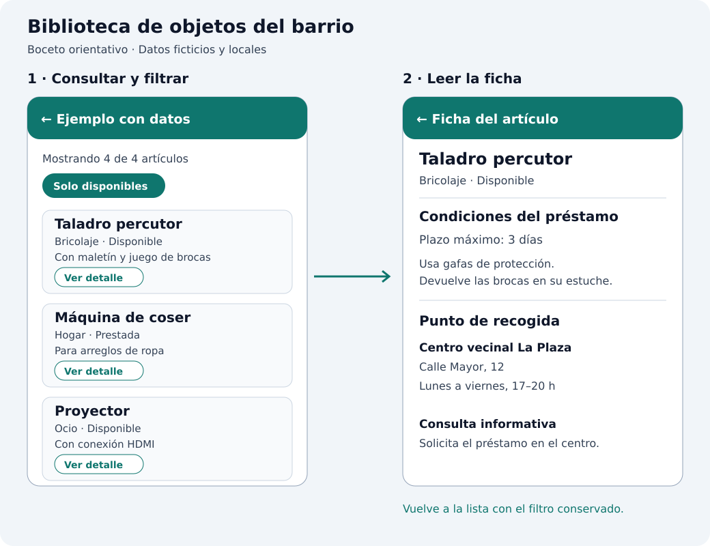

## Una biblioteca de objetos del barrio

Vamos a ampliar `catalogo_widgets` con **Ejemplo con datos**, una miniaplicación para consultar una biblioteca de objetos: un servicio vecinal que presta herramientas, material de ocio y pequeños aparatos que usamos de forma ocasional.

Su propósito es ayudar a una persona a **encontrar un objeto que necesita, comprobar si está disponible y saber dónde recogerlo**. Por ejemplo, alguien que quiere montar una estantería podrá localizar un taladro, consultar sus condiciones de préstamo y ver la dirección del centro donde se recoge.

## Qué hará la aplicación

Al abrir la entrada del catálogo veremos una lista de artículos: un taladro, una máquina de coser, un proyector y una tienda de campaña. Cada tarjeta mostrará su categoría, descripción breve y estado. La cabecera indicará cuántos artículos se están mostrando. El botón **Solo disponibles** permitirá ocultar los que estén prestados o en mantenimiento.

Cada tarjeta tendrá un botón **Ver detalle**. Al pulsarlo se abrirá la ficha del artículo seleccionado, con su descripción, categoría, estado, plazo máximo de préstamo, recomendaciones de uso y punto de recogida con dirección y horario. Desde la flecha de la barra volveremos a la lista conservando el filtro que habíamos elegido.



La imagen es un **boceto del recorrido y la información**, no una captura de Flutter. Implementaremos la interfaz con los widgets Material que ya conocemos; su apariencia concreta dependerá del tema de la aplicación.

Los datos serán ficticios y estarán definidos en Dart. La aplicación funcionará sin red, API, base de datos ni paquetes adicionales. Será una consulta del catálogo: no tramitará reservas ni modificará la disponibilidad. El filtro solo cambia lo que vemos y se reinicia al salir de esta miniaplicación y volver a abrirla desde el catálogo.

## Qué practicaremos

Combinaremos `Scaffold`, `AppBar`, `ListView`, `Card`, `Text`, `Row`, `Column`, `CircleAvatar`, `Divider` y botones en una interfaz con una utilidad concreta. El mismo artículo aparecerá resumido en la lista y ampliado en su ficha: no copiaremos sus datos en otra lista ni crearemos una pantalla distinta para cada objeto.

Hasta ahora hemos pasado textos y callbacks a componentes. Ahora necesitamos relacionar datos y mantener una selección. Desarrollaremos lo previsto en [Qué añadiremos cuando aparezcan otras responsabilidades](../configuracion-de-un-asistente-de-ia/el-proyecto-del-catalogo/#-qué-añadiremos-cuando-aparezcan-otras-responsabilidades).

La arquitectura se organiza en dos capas principales: **datos** (servicio y repositorio) e **interfaz** (ViewModel y vistas). Los DTO representan la fuente y los modelos de dominio representan la información de la aplicación. No hay una capa distinta por cada carpeta: separaremos responsabilidades dentro de cada capa y explicaremos su propósito antes de implementar cada pieza.

| Pieza | Responsabilidad en esta miniaplicación |
| --- | --- |
| Modelos de dominio | Representar los artículos, categorías y centros que usa la aplicación. |
| Modelos de datos (DTO) | Representar el formato de la fuente, con códigos de estado y plazos en horas. |
| Servicio local | Proporcionar los cuatro artículos ficticios como DTO de la fuente. |
| Repositorio | Convertir los DTO a dominio, validar los datos y ofrecer una colección inmutable. |
| ViewModel | Mantener el filtro de disponibilidad y calcular la lista visible. |
| Vistas | Mostrar el listado y la ficha; comunicar acciones y abrir el detalle. |

El recorrido de lectura será **vista → ViewModel → repositorio → servicio**. El servicio devuelve DTO; el repositorio los convierte en modelos de dominio para el ViewModel y las vistas. Al filtrar, el ViewModel cambia la selección y avisa a la vista. Al abrir una ficha, la vista entrega el artículo seleccionado a la pantalla de detalle mediante su constructor.

## Estructura que añadiremos

```text
lib/
├── domain/models/
│   ├── articulo.dart
│   ├── categoria.dart
│   └── punto_recogida.dart
├── data/
│   ├── models/articulo_dto.dart
│   ├── services/articulos_local_service.dart
│   └── repositories/articulos_repository.dart
└── ui/prestamos/
    ├── view_models/prestamos_view_model.dart
    └── ui/
        ├── ejemplo_datos_pantalla.dart
        ├── tarjeta_articulo.dart
        └── articulo_detalle_pantalla.dart
```

Conserva `lib/ui/catalogo/ui/` y todas sus entradas. La funcionalidad `prestamos` tendrá sus propias vistas y su ViewModel, siguiendo las rutas del proyecto. El detalle recibirá un modelo inmutable y no necesitará un segundo ViewModel porque no tiene estado ni operaciones propios.

El servicio local será síncrono. Añadiremos `data/models` para representar el contrato de una fuente simulada distinto del dominio. No necesitamos casos de uso para estas operaciones sencillas. Aplicamos las responsabilidades de la [guía de arquitectura de Flutter](https://docs.flutter.dev/app-architecture/guide) a un ejemplo pequeño.

## Apartados

1. [Modelos relacionados](./modelos/).
2. [Servicio local y repositorio](./datos-locales/).
3. [ViewModel, pantalla y catálogo](./pantalla-y-estado/).
4. [Ficha de detalle y comprobaciones](./detalle/).
