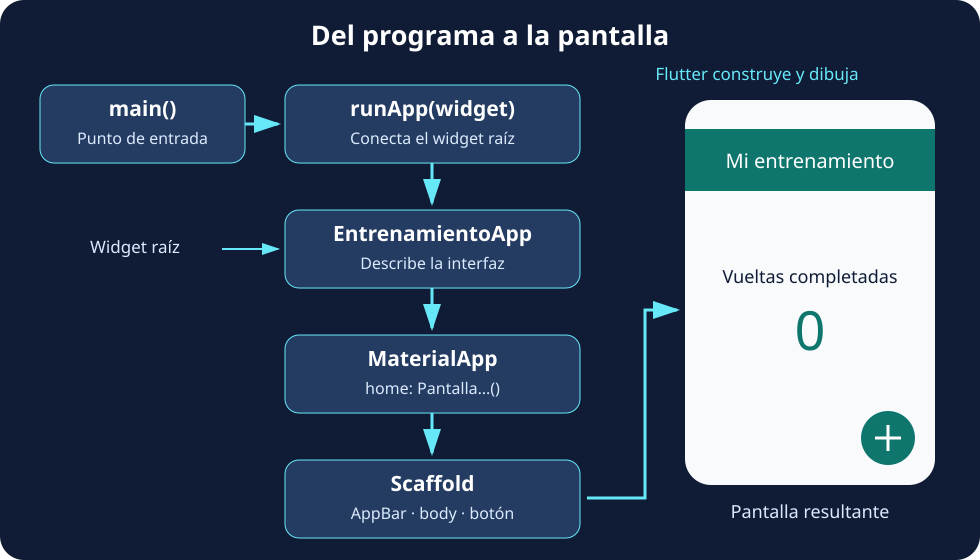

Reemplaza **todo `lib/main.dart`** por este programa:

```dart
import 'package:flutter/material.dart';

void main() {
  runApp(
    const Text(
      '¡Vamos a entrenar!',
      textDirection: TextDirection.ltr,
    ),
  );
}
```

El programa es pequeño, pero ya contiene tres piezas importantes:

| Pieza | Qué hace |
| --- | --- |
| `import` | Permite utilizar los componentes que exporta la biblioteca Material de Flutter. |
| `main` | Es el punto de entrada del programa Dart. |
| `runApp` | Recibe un widget y lo establece como raíz de la interfaz. |

`Text` recibe la cadena como argumento posicional. `textDirection` es un argumento con nombre: `TextDirection.ltr` indica lectura de izquierda a derecha. **En este ejemplo aún no hay un widget antecesor que proporcione la dirección**, por lo que la indicamos explícitamente. Más adelante, `MaterialApp` aportará ese contexto.

El saludo aparece sin la estructura ni los estilos habituales de una pantalla Material y puede coincidir con zonas del sistema. Es un primer experimento para entender el arranque, no la pantalla final. Puedes consultar el comportamiento de arranque en la [referencia de `runApp`](https://api.flutter.dev/flutter/widgets/runApp.html).

### ¿Qué hace runApp?

**`runApp` conecta el widget que le entregamos con la vista de la aplicación y pone en marcha la construcción de su interfaz.** A partir de ese widget raíz, Flutter incorpora sus descendientes al árbol, calcula el espacio que necesitan y dibuja el resultado en pantalla. En este primer programa la raíz es `Text`; cuando creemos nuestra clase, será `EntrenamientoApp`.

Podemos distinguir las responsabilidades: **`main` inicia el programa Dart, `runApp` conecta su interfaz con Flutter y `build` describe el contenido de cada widget propio**. `runApp` recibe una instancia de widget: en `runApp(const EntrenamientoApp())`, `EntrenamientoApp()` llama al constructor y su resultado se entrega a la función.

El siguiente esquema anticipa la estructura que construiremos en los próximos pasos. Las flechas muestran el arranque y la composición de la interfaz; no son llamadas a `runApp` en cada nivel.



:::note[Se llama al arrancar, no al pulsar el botón]
En esta aplicación llamamos a `runApp` una vez, desde `main`. Para actualizar el contador utilizaremos `setState`: Flutter reconstruye la parte correspondiente del árbol. **No necesitamos volver a llamar a `runApp` para mostrar cada nuevo valor.** Tampoco necesitamos llamar manualmente a `build`; Flutter gestiona esas llamadas.
:::

### Centra el texto

Mantén el `import` y sustituye `main` por:

```dart
void main() {
  runApp(
    const Center(
      child: Text(
        '¡Vamos a entrenar!',
        textDirection: TextDirection.ltr,
      ),
    ),
  );
}
```

Ahora `Center` es el padre del texto y lo coloca en el centro del espacio disponible. **No cambiamos el texto para centrarlo: lo combinamos con otro widget que resuelve la posición.**

:::tip[Qué significa const 💡]
`const` crea una configuración constante cuando el constructor y sus argumentos lo permiten. Dentro de `const Center(...)`, el `Text` ya está en un contexto constante y no necesita repetir la palabra. Flutter puede reutilizar esas instancias y evitar trabajo de actualización, pero esto **no congela la pantalla ni impide cualquier reconstrucción**. Un `StatefulWidget` creado con `const` también puede tener un `State` mutable.
:::
